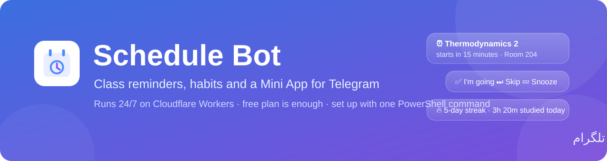
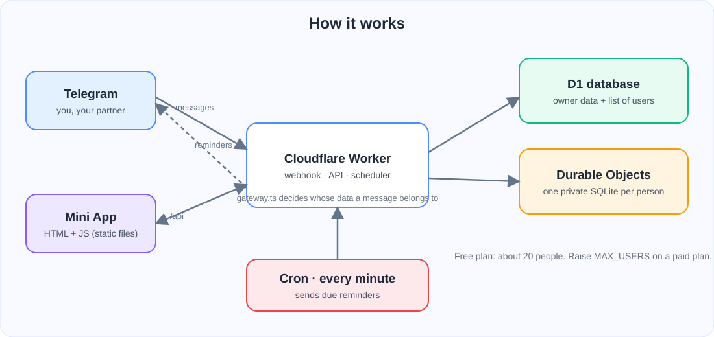
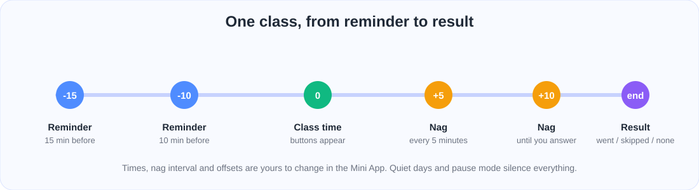

<div align="center">



<br>

[](LICENSE)
[](https://workers.cloudflare.com/)
[](https://www.typescriptlang.org/)

[English](README.md) · **فارسی**

</div>

<div dir="rtl">

---

## این پروژه چیه؟

**Schedule Bot** یه ربات شخصی تلگرامه که برنامه‌ی کلاس‌هات رو می‌دونه و حواسش بهت هست.
قبل از هر کلاس یادآوری می‌کنه، تا جواب ندی با ملایمت تکرار می‌کنه، مطالعه و عادت‌هات رو ثبت می‌کنه،
و یه **Mini App** کامل (یه برنامه‌ی کوچیک داخل خود تلگرام) برای مدیریت همه‌چیز داره.
اگه بخوای، یه **پارتنر** هم می‌تونه به ربات وصل بشه تا وقتی کلی درس خوندی تشویقت کنه و وقتی شل گرفتی یه تلنگر بزنه.

برای دانشجوها ساخته شده، ولی برای هر برنامه‌ی هفتگی کار می‌کنه.
زبان ربات **فارسی** و تقویمش **شمسیه**.

> روی **پلن رایگان** Cloudflare اجرا می‌شه. نه سرور اجاره می‌خوای، نه کامپیوتری که همیشه روشن باشه.

<div align="center">

<br><sub>تصویر نمونه‌ی Mini App. برنامه‌ی واقعی با تم روشن یا تیره‌ی تلگرامت هماهنگ می‌شه.</sub>
</div>

## امکانات

| | |
|---|---|
| ⏰ **یادآوری هوشمند** | ۱۵ و ۱۰ دقیقه قبل از کلاس و موقع شروع (برای هر درس قابل تغییره)، بعد هر ۵ دقیقه تا جواب بدی. |
| 🔘 **جواب با یه لمس** | *میرم* / *کلاس برگزار نمی‌شه* / *نمیرم (با دلیل)* / *بعداً یادآوری کن*. جوابت برای آمار ثبت می‌شه. |
| 📱 **Mini App** | تب‌های امروز، هفته، پیام‌ها، پیشرفت، آمار و تنظیمات. افزودن و ویرایش درس، امتحان، کار و برنامه‌ی کاری. |
| 🗓 **ورود برنامه** | متن برنامه رو (حتی از چت با هوش مصنوعی) بچسبون تا درس‌ها ساخته بشن. خروجی **ICS** (تقویم) و **CSV**. |
| 📚 **ثبت مطالعه** | تایمر، ثبت دستی، پومودورو، هدف روزانه و هفتگی برای هر دسته، سطح و نشان. |
| ✅ **عادت و کار** | زنجیره‌ی عادت‌ها (بعضی خودکار از زمان مطالعه تیک می‌خورن)، کار تکراری، نمره و معدل. |
| 💌 **پارتنر** | با یه لینک دعوت. پیام و چالش برات می‌فرسته و ربات متن‌های آماده‌ی بامزه می‌فرسته. |
| 🌙 **روز ساکت و توقف** | ربات رو برای یه روز، یه بازه‌ی ساعتی (حتی رد شدن از نیمه‌شب)، چند ساعت یا کل تعطیلات ساکت کن. |
| 👥 **حالت عمومی** | هر کسی ربات رو استارت کنه یه **دیتابیس خصوصی** داره. تعداد آدم‌ها رو با `MAX_USERS` محدود کن. |
| 💾 **بکاپ** | هر هفته یه بکاپ JSON توی تلگرام برات می‌آد، یا هر وقت خواستی دکمه رو بزن. |

## چطور کار می‌کنه؟

<div align="center">

</div>

- **تلگرام** هر پیام و هر دکمه رو به آدرس `/webhook` می‌فرسته.
- **Worker** جواب پیام‌ها رو می‌ده، API برنامه رو زیر `/api/*` سرو می‌کنه و فایل‌های Mini App رو از پوشه‌ی `public/` می‌ده.
- **D1** داده‌ی صاحب ربات و لیست کاربرها رو نگه می‌داره. بقیه هرکدوم یه **Durable Object با SQLite** مخصوص خودشون دارن، پس داده‌ها قاطی نمی‌شه.
- یه **cron** هر دقیقه اجرا می‌شه، یادآوری‌های رسیده رو پیدا می‌کنه و می‌فرسته (هر یادآوری فقط یک بار «گرفته می‌شه» و دوبار نمی‌ره).

<div align="center">

</div>

## نصب سریع (ویندوز، حدود ۱۰ دقیقه)

قبل از شروع این سه تا رو آماده کن:

1. یه **[حساب رایگان Cloudflare](https://dash.cloudflare.com/sign-up)**.
2. توکن ربات از **[@BotFather](https://t.me/BotFather)** توی تلگرام (دستور `/newbot`).
3. آیدی عددی تلگرامت: به **[@userinfobot](https://t.me/userinfobot)** پیام بده و عددی که می‌ده رو کپی کن.

بعد **PowerShell** رو باز کن و فقط همین یه خط رو بچسبون:

</div>

```powershell
irm https://raw.githubusercontent.com/alireza-yahyae/schedule-bot/main/install.ps1 | iex
```

<div dir="rtl">

نصب‌کننده پروژه رو دانلود می‌کنه، اگه Node.js نبود نصبش می‌کنه، مرورگر رو باز می‌کنه که وارد Cloudflare بشی،
دیتابیس می‌سازه، ربات رو منتشر می‌کنه، رمزها رو امن ذخیره می‌کنه و تلگرام رو وصل می‌کنه.
آخرش آدرس رباتت رو نشون می‌ده. ربات رو توی تلگرام باز کن، `/start` بفرست و تمام.

<details>
<summary><b>می‌خوای دستی انجام بدی؟ (git clone)</b></summary>

</div>

```powershell
git clone https://github.com/alireza-yahyae/schedule-bot.git
cd schedule-bot
powershell -ExecutionPolicy Bypass -File .\setup.ps1
```

<div dir="rtl">

</details>

### به‌روزرسانی

</div>

```powershell
powershell -ExecutionPolicy Bypass -File .\update.ps1
```

<div dir="rtl">

آخرین نسخه رو می‌گیره، تغییرات دیتابیس رو اعمال می‌کنه و منتشر می‌کنه. فایل `wrangler.toml` و رمزهات سر جاشون می‌مونن.

## تنظیمات

| اسم | نوع | کارش |
|---|---|---|
| `BOT_TOKEN` | رمز | توکن @BotFather. |
| `WEBHOOK_SECRET` | رمز | یه متن تصادفی. تلگرام با هر پیام برمی‌گردونه تا غریبه‌ها نتونن پیام جعلی بفرستن. |
| `OWNER_ID` | رمز | آیدی عددی تلگرام تو. تو صاحب رباتی؛ بقیه دیتابیس خصوصی می‌گیرن (حالت عمومی). |
| `MAX_USERS` | متغیر | تعداد آدم‌هایی که می‌تونن از ربات استفاده کنن. حدود ۲۰ تا روی پلن رایگان جواب می‌ده. |
| `APP_URL` | متغیر | آدرس Worker تو. دکمه‌ی Mini App اون رو باز می‌کنه. نصب‌کننده خودش پرش می‌کنه. |

رمزها توی خود Cloudflare هستن و هیچ‌وقت داخل این ریپو قرار نمی‌گیرن. فایل `wrangler.toml` هم commit نمی‌شه چون شناسه‌ی دیتابیس شخصی تو توشه.

## دستورهای ربات

| دستور | کارش |
|---|---|
| `/app` | باز کردن Mini App |
| `/today` و `/tomorrow` و `/week` | نمایش برنامه |
| `/courses` | درس‌ها و تاریخ امتحان‌ها |
| `/study 90` و `/work 90` | ثبت ۹۰ دقیقه مطالعه یا کار |
| `/slacking` و `/studied` و `/remind_partner` | فرستادن پیام آماده به پارتنر |
| `/pause 3` و `/resume` | توقف یادآوری برای ۳ ساعت، یا شروع دوباره |
| `/test` | ساخت یه کلاس تستی چند دقیقه بعد |
| `/delete_me` | (حالت عمومی) پاک کردن همه‌ی اطلاعاتت |

## عیب‌یابی

- **ربات جواب نمی‌ده.** آدرس `https://<آدرس-تو>.workers.dev/health` رو باز کن؛ باید `"ok": true` ببینی. بعد دوباره `scripts\set-webhook.ps1` رو اجرا کن و `last_error_message` رو بخون.
- **یادآوری نمی‌آد.** چک کن ربات متوقف نباشه (تنظیمات ← توقف یا حالت تعطیلات) و منطقه‌ی زمانی درست باشه.
- **آدم جدید نمی‌تونه وارد بشه (ربات می‌گه پره).** `MAX_USERS` رو توی `wrangler.toml` زیاد کن و `npm run deploy` بزن.
- **PowerShell می‌گه اسکریپت‌ها بسته‌ست.** از `powershell -ExecutionPolicy Bypass -File .\setup.ps1` استفاده کن.

راهنمای قدم‌به‌قدم قدیمی‌تر هم توی [docs/fa](docs/fa) هست.

## مشارکت

مشکل (Issue) و درخواست تغییر (Pull Request) خوش‌اومده. تغییرها رو کوچیک نگه دار، `npm run typecheck` رو اجرا کن و به‌جای ویرایش یه migration قدیمی، یه migration جدید بساز.

## مجوز

[MIT](LICENSE) © 2026 alireza

</div>
