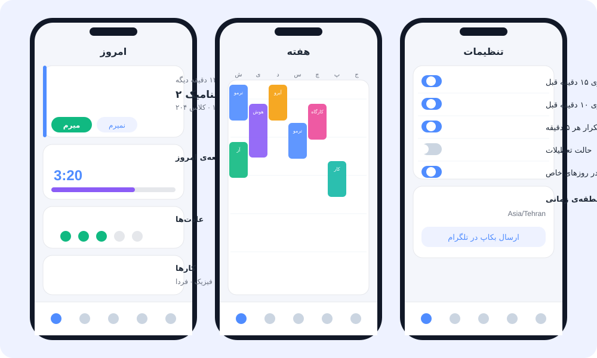

<div align="center">


<br>

[](LICENSE)
[](https://workers.cloudflare.com/)
[](https://www.typescriptlang.org/)
[](https://github.com/alireza-yahyae/schedule-bot/actions/workflows/ci.yml)

**English** · [فارسی](README.fa.md)

</div>

---

## What is this?

**Schedule Bot** is a personal Telegram bot that knows your timetable and keeps you on track.
It reminds you before every class, nags you (politely) until you answer, tracks study time and habits,
and has a full **Telegram Mini App** (a small web app inside Telegram) to manage everything.
Optionally, a **partner** can join the bot to cheer you on, or to give you a nudge when you slack off.

It is built for university students, but it works for any weekly schedule.
The interface language is **Persian (Farsi)** with a Jalali calendar; the code and this documentation are in English.

> It runs on Cloudflare's **free plan**. No server to rent, no computer that must stay on.

<div align="center">

<br><sub>Illustration of the Mini App (Today · Week · Settings). The real app follows your Telegram light or dark theme.</sub>
</div>

## Features

| | |
|---|---|
| ⏰ **Smart reminders** | 15 and 10 minutes before class and at class time (all configurable per course), then a repeat every 5 minutes until you answer. |
| 🔘 **One-tap answers** | *I'm going* / *Class is cancelled* / *Skip (with a reason)* / *Snooze*. Your answer is stored for the statistics. |
| 📱 **Mini App** | Today, Week grid, Messages, Growth, Stats and Settings tabs. Add and edit courses, exams, tasks and work events. |
| 🗓 **Timetable import** | Paste text (even from an AI chat) and the app builds the courses. Export to **ICS** (calendar) and **CSV**. |
| 📚 **Study tracking** | Timer, manual log, Pomodoro focus sessions, daily and weekly goals per category, levels and badges. |
| ✅ **Habits and tasks** | Habit streaks (some tick themselves from your study time), repeating tasks, grades and GPA. |
| 💌 **Partner** | Invite one person by link. They can send you messages and challenges, and the bot can send ready-made funny texts when you study a lot or slack off. |
| 🌙 **Quiet days and pause** | Silence the bot for a day, a time window (even across midnight), a few hours, or a whole holiday. |
| 👥 **Public bot mode** | Everyone who starts your bot gets a **private database** (a Durable Object). Limit the number of people with `MAX_USERS`. |
| 💾 **Backups** | A weekly JSON backup is sent to you in Telegram, or press a button any time. |

## How it works

<div align="center">

</div>

- **Telegram** sends every message and button press to the Worker's `/webhook`.
- The **Worker** (`src/index.ts`) answers messages, serves the Mini App's API under `/api/*`, and serves the static Mini App files from `public/`.
- **D1** holds the owner's data and the list of users. Every other person gets their own **Durable Object with SQLite**, so data never mixes.
- A **cron trigger** runs every minute, finds reminders that are due, and sends them (each reminder is claimed once, so it never goes out twice).

<div align="center">

</div>

## Quick start (Windows, about 10 minutes)

You need three things before you begin:

1. A free **[Cloudflare account](https://dash.cloudflare.com/sign-up)**.
2. A bot token from **[@BotFather](https://t.me/BotFather)** in Telegram (send `/newbot`).
3. Your numeric Telegram id: message **[@userinfobot](https://t.me/userinfobot)** and copy the number it shows.

Then open **PowerShell** and paste this one line:

```powershell
irm https://raw.githubusercontent.com/alireza-yahyae/schedule-bot/main/install.ps1 | iex
```

The installer downloads the project, installs Node.js if needed, opens your browser so you can sign in to Cloudflare,
creates the database, deploys the bot, stores your secrets safely and connects Telegram.
At the end it prints the address of your bot. Open the bot in Telegram, send `/start`, and you are done.

<details>
<summary><b>Prefer to do it by hand? (git clone)</b></summary>

```powershell
git clone https://github.com/alireza-yahyae/schedule-bot.git
cd schedule-bot
powershell -ExecutionPolicy Bypass -File .\setup.ps1
```

Or step by step:

```powershell
npm install
npx wrangler login
copy wrangler.example.toml wrangler.toml      # then put your own D1 database id in it
npx wrangler d1 create schedule-bot-db        # prints the database id
npm run db:migrate
npm run deploy
# secrets (you will be asked to type each value)
npx wrangler secret put BOT_TOKEN
npx wrangler secret put WEBHOOK_SECRET        # any long random text
npx wrangler secret put OWNER_ID              # your numeric Telegram id
powershell -ExecutionPolicy Bypass -File .\scripts\set-webhook.ps1
```
</details>

### Updating later

```powershell
powershell -ExecutionPolicy Bypass -File .\update.ps1
```

It pulls the newest version, applies database changes and deploys. Your `wrangler.toml` and secrets are kept.

## Configuration

| Name | Kind | What it does |
|---|---|---|
| `BOT_TOKEN` | secret | The token from @BotFather. |
| `WEBHOOK_SECRET` | secret | Random text. Telegram sends it back with every update so strangers cannot fake updates. |
| `OWNER_ID` | secret | Your numeric Telegram id. You are the owner; everyone else gets a private database (public mode). |
| `MAX_USERS` | variable | How many people may use the bot. About 20 fits the free plan. |
| `APP_URL` | variable | The address of your Worker. The Mini App button opens it. The installer fills it in for you. |

Secrets live in Cloudflare, never in this repository. `wrangler.toml` is not committed either, because it contains your own database id.

## Bot commands

| Command | What it does |
|---|---|
| `/app` | Open the Mini App |
| `/today`, `/tomorrow`, `/week` | Show your schedule |
| `/courses` | Courses and exam dates |
| `/study 90`, `/work 90` | Log 90 minutes of study or work |
| `/slacking`, `/studied`, `/remind_partner` | Send a ready-made message to your partner |
| `/pause 3`, `/resume` | Pause reminders for 3 hours, or resume |
| `/test` | Create a test class a few minutes from now |
| `/delete_me` | (public mode) Erase all your stored data |

## Project structure

```
src/            Worker code (TypeScript): webhook, gateway, scheduler, API, partner features
migrations/     Database schema (SQL), applied to D1 and to every person's own database
public/         The Mini App (plain HTML, CSS and JavaScript, no build step)
scripts/        Helpers: webhook registration, tenant schema generator
docs/           Images and the Persian step-by-step guides
setup.ps1       Guided first-time setup
update.ps1      One-command update
install.ps1     The one-line installer
```

<details>
<summary><b>For developers</b></summary>

```powershell
npm install
npm run typecheck        # TypeScript check
npm run gen:schema       # rebuilds src/tenant-schema.generated.ts from /migrations
npm run dev              # local Worker (cron can be triggered by hand)
```

- Every schema change is a **new** file in `migrations/` (never edit an old one). Run `npm run gen:schema` afterwards; CI fails if the generated file is out of date.
- Reminders are de-duplicated through the `sent_log` table (`claim` → send → `markSent`), so a retry can never double-send.
- All times are stored as UTC seconds and converted with the person's time zone; the week starts on Saturday.
</details>

## Troubleshooting

- **The bot does not answer.** Open `https://<your-worker>.workers.dev/health`. You should see `"ok": true`. Then run `scripts\set-webhook.ps1` again and read `last_error_message`.
- **No reminders arrive.** Check that the bot is not paused (Settings → pause / holiday) and that the time zone is right.
- **New people cannot join (the bot says it is full).** Raise `MAX_USERS` in `wrangler.toml` and run `npm run deploy`.
- **PowerShell says scripts are disabled.** Use `powershell -ExecutionPolicy Bypass -File .\setup.ps1`, as in the examples above.

## Contributing

Issues and pull requests are welcome. Please keep changes small, run `npm run typecheck`, and add a new migration instead of editing an old one.

## License

[MIT](LICENSE) © 2026 alireza
